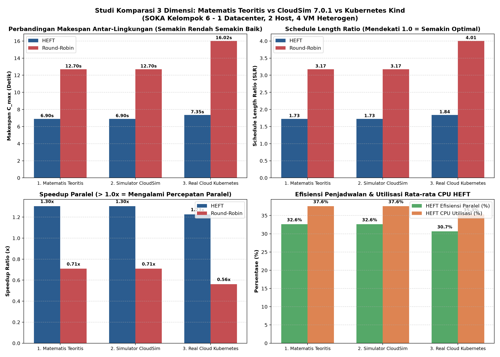
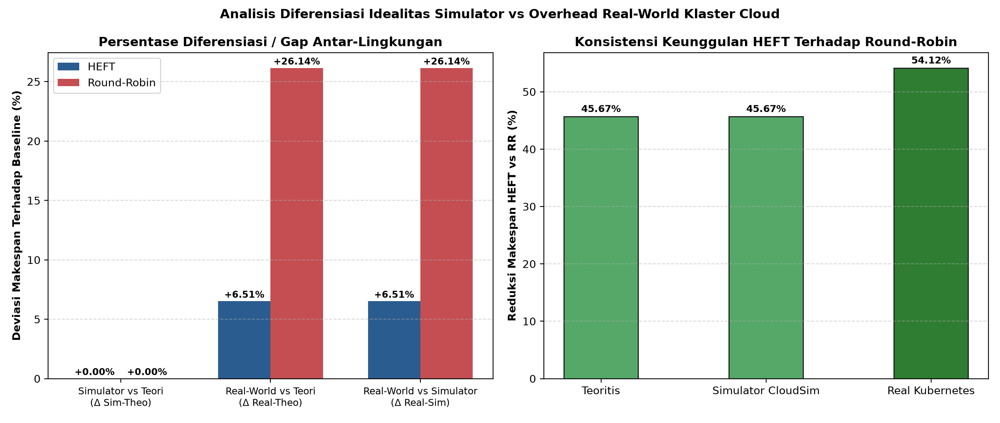
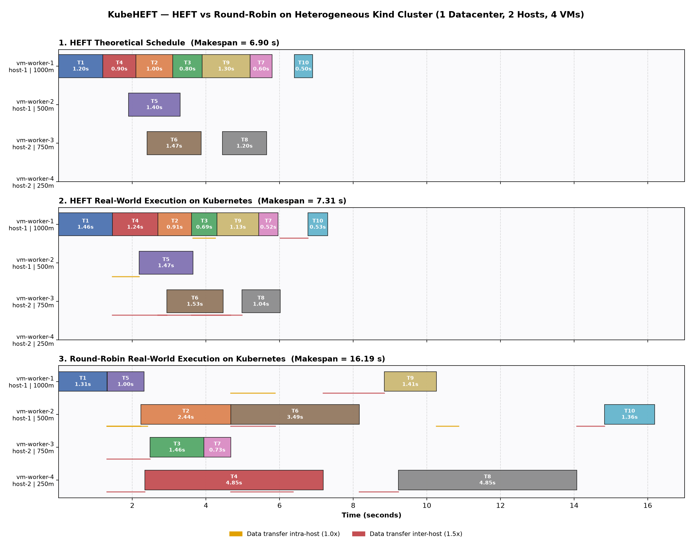
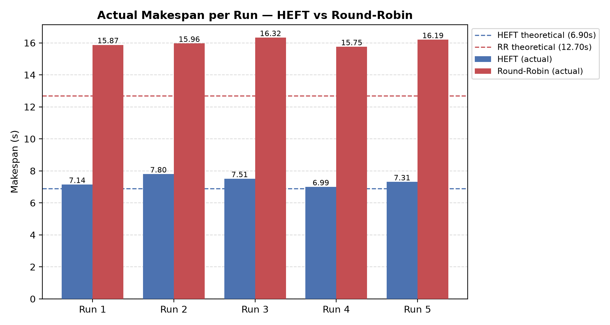

# KubeHEFT: Real-World Heuristic Task Scheduler pada Klaster Cloud Heterogen

[](https://kubernetes.io/)
[](https://www.python.org/)
[](https://fastapi.tiangolo.com/)
[](https://www.docker.com/)

> **Tugas Besar Mata Kuliah:** Strategi Optimasi Komputasi Awan (SOKA) — Semester 5  
> **Topik:** Orkestrasi & Penjadwalan Tugas DAG (*Directed Acyclic Graph*) Menggunakan Algoritma HEFT pada Lingkungan *Heterogeneous Cloud Computing*  
> **Kelompok:** 6  
> **Referensi Utama:** H. Topcuoglu, S. Hariri, and Min-You Wu, *"Performance-Effective and Low-Complexity Task Scheduling for Heterogeneous Computing"*, **IEEE Transactions on Parallel and Distributed Systems (TPDS)**, Vol. 13, No. 3, pp. 260–274, Mar. 2002.

---

## 📑 Daftar Isi
1. [Ringkasan Eksekutif & Hasil Eksperimen](#1-ringkasan-eksekutif--hasil-eksperimen)
2. [Arsitektur & Infrastruktur Klaster](#2-arsitektur--infrastruktur-klaster)
   - [Pemetaan Konsep Cloud ke Kubernetes](#pemetaan-konsep-cloud-ke-kubernetes)
   - [Topologi Jaringan & Spesifikasi Pod (VM)](#topologi-jaringan--spesifikasi-pod-vm)
   - [Mekanisme Heterogenitas CPU (CFS Quota)](#mekanisme-heterogenitas-cpu-cfs-quota)
   - [Model Komunikasi Jaringan Sadar Topologi](#model-komunikasi-jaringan-sadar-topologi)
3. [Spesifikasi Matematis Algoritma HEFT](#3-spesifikasi-matematis-algoritma-heft)
   - [Fase 1: Task Prioritizing (Upward Rank)](#fase-1-task-prioritizing-upward-rank)
   - [Fase 2: Processor Selection (EFT & Insertion Policy)](#fase-2-processor-selection-eft--insertion-policy)
   - [Baseline Scheduler (Topological Round-Robin)](#baseline-scheduler-topological-round-robin)
   - [Metrik Evaluasi (Makespan, SLR, Speedup)](#metrik-evaluasi-makespan-slr-speedup)
4. [Dataset Graf Tugas (10-Node DAG)](#4-dataset-graf-tugas-10-node-dag)
5. [Visualisasi Hasil Pengujian](#5-visualisasi-hasil-pengujian)
6. [Panduan Lengkap Instalasi & Cara Menjalankan](#6-panduan-lengkap-instalasi--cara-menjalankan)
   - [Prasyarat Sistem](#prasyarat-sistem)
   - [Instalasi Kind & Kubectl](#instalasi-kind--kubectl)
   - [Langkah 1: Kloning Repositori](#langkah-1-kloning-repositori)
   - [Langkah 2: Provisioning Klaster Cloud](#langkah-2-provisioning-klaster-cloud)
   - [Langkah 3: Persiapan Environment Python](#langkah-3-persiapan-environment-python)
   - [Langkah 4: Eksekusi Eksperimen Benchmark](#langkah-4-eksekusi-eksperimen-benchmark)
   - [Langkah 5: Membaca Hasil & Laporan](#langkah-5-membaca-hasil--laporan)
   - [Langkah 6: Pembersihan Klaster (Teardown)](#langkah-6-pembersihan-klaster-teardown)
7. [Panduan Uji Endpoint Manual & Troubleshooting](#7-panduan-uji-endpoint-manual--troubleshooting)
8. [Struktur Direktori Repositori](#8-struktur-direktori-repositori)

---

## 1. Ringkasan Eksekutif & Hasil Eksperimen

Penjadwalan sekumpulan tugas yang saling bergantung (*Directed Acyclic Graph* / DAG) ke prosesor heterogen adalah masalah **NP-complete**. Proyek ini merealisasikan **Studi Komparasi Tiga Dimensi** yang mengkaji algoritma heuristik **Heterogeneous Earliest Finish Time (HEFT)** terhadap algoritma baseline **Topological Round-Robin (RR)** pada:
1. **Model Matematis Teoritis:** Kalkulasi analitis formulasi Topcuoglu et al. (IEEE TPDS 2002).
2. **Simulator CloudSim 7.0.1:** Simulasi discrete-event deterministik ideal tanpa delay sistem operasi.
3. **Real-World Kubernetes (Kind):** Klaster komputasi awan nyata dengan pembatasan cgroups CFS Quota dan HTTP network transfer data riil (5 kali pengujian berulang).

📄 **Laporan Akademis Lengkap:** [`LAPORAN_AKHIR_SOKA_KELOMPOK_6.md`](LAPORAN_AKHIR_SOKA_KELOMPOK_6.md)  
📋 **PRD & Rencana Implementasi:** [`PRD_REVISI_SOKA_KEL_6.md`](PRD_REVISI_SOKA_KEL_6.md)

### Tabel Utama Komparasi Tiga Dimensi (Tri-Dimensional Benchmark)
| Metrik Kinerja | Algoritma | 1. Matematis Teoritis | 2. Simulator (CloudSim 7.0.1) | 3. Real Cloud (Kubernetes Mean ± Std) | Diferensiasi Real vs Sim (Δ%) |
| :--- | :--- | :---: | :---: | :---: | :---: |
| **Makespan ($C_{\max}$)** | **HEFT** | 6.900 s | 6.900 s | **7.349 ± 0.314 s** | **+6.51%** |
| | **Round-Robin** | 12.700 s | 12.700 s | **16.020 ± 0.234 s** | **+26.14%** |
| **Schedule Length Ratio ($SLR$)** | **HEFT** | 1.725 | 1.725 | **1.837 ± 0.079** | **+6.51%** |
| | **Round-Robin** | 3.175 | 3.175 | **4.005 ± 0.059** | **+26.14%** |
| **Speedup ($S$)** | **HEFT** | 1.304x | 1.304x | **1.226 ± 0.052x** | **-5.95%** |
| | **Round-Robin** | 0.709x | 0.709x | **0.562 ± 0.008x** | **-20.75%** |
| **Parallel Efficiency ($\eta$)** | **HEFT** | 32.61% | 32.61% | **30.66 ± 1.30%** | **-5.97%** |
| | **Round-Robin** | 17.72% | 17.72% | **14.05 ± 0.21%** | **-20.72%** |
| **Rata-rata Utilisasi CPU ($U_{avg}$)** | **HEFT** | 37.57% | 37.57% | **35.33 ± 1.49%** | **-5.97%** |
| | **Round-Robin** | 34.39% | 34.39% | **27.27 ± 0.40%** | **-20.72%** |
| **Communication Overhead ($O_{comm}$)** | **HEFT** | 7.15 s | 7.15 s | **6.55 s** | **-8.39%** |
| | **Round-Robin** | 10.55 s | 10.55 s | **10.75 s** | **+1.90%** |
| **Reduksi Makespan HEFT vs RR** | **Efisiensi HEFT** | **45.67%** | **45.67%** | **54.12%** | **HEFT Unggul Konsisten** |

> 🚀 **Kesimpulan Kinerja:**
> 1. **Superioritas HEFT:** HEFT berhasil memangkas makespan hingga **54.12%** di Kubernetes nyata dibandingkan baseline Round-Robin.
> 2. **Diferensiasi Fisik:** Makespan HEFT di dunia nyata mengalami peningkatan **+6.51%** dibanding simulator CloudSim akibat variabilitas sistem operasi (*CFS quota throttling jitter*, *Linux veth socket delay*, dan *TCP handshakes*). Nilai gap ini wajar dan membuktikan reliabilitas model eksperimen.

---

## 2. Arsitektur & Infrastruktur Klaster

### Pemetaan Konsep Cloud ke Kubernetes

| Komponen Cloud Nyata | Pemetaan Ekosistem Kubernetes | Implementasi Teknis |
| :--- | :--- | :--- |
| **Datacenter** | 1 Kind Cluster (`heft-datacenter`) | Docker Bridge Network terisolasi dengan 1 Control Plane node |
| **Host 1 (Bare-Metal)** | Worker Node 1 (`heft-datacenter-worker`) | Docker container berlabel `topology.host: host-1` |
| **Host 2 (Bare-Metal)** | Worker Node 2 (`heft-datacenter-worker2`) | Docker container berlabel `topology.host: host-2` |
| **VM 1 s.d. VM 4** | 4 Pod Heterogen (`vm-worker-1` s.d. `4`) | Dibatasi via Linux cgroups CFS Quota (`limits.cpu`) |
| **Switch Jaringan Host** | Kubernetes Service & DNS CoreDNS | NodePort Service + ClusterIP port 8000 |
| **Master Orchestrator** | Host Machine / WSL2 (Python Async) | HEFT Calculator, DAG Dispatcher, Matplotlib Visualizer |

```text
+-----------------------------------------------------------------------------------+
|                        MASTER ORCHESTRATOR (Host / WSL2)                          |
|  +------------------+   +---------------------+   +----------------------------+  |
|  | DAG & Matrix     |-->| HEFT & Round-Robin  |-->| Async HTTP Task Dispatcher |  |
|  | Loader (JSON)    |   | Scheduling Engine   |   | (httpx + asyncio)          |  |
|  +------------------+   +---------------------+   +-------------+--------------+  |
+-----------------------------------------------------------------|-----------------+
                                                                  |
                         HTTP REST API (Port 30081 - 30084)       |
                                                                  v
+-----------------------------------------------------------------------------------+
|                     DATACENTER: KIND CLUSTER (heft-datacenter)                    |
|                                                                                   |
|  +-------------------------------------+   +-----------------------------------+  |
|  |           HOST 1 (Node 1)           |   |          HOST 2 (Node 2)          |  |
|  |  label: topology.host = host-1      |   |  label: topology.host = host-2    |  |
|  |                                     |   |                                   |  |
|  |  +---------------+ +-------------+  |   |  +-------------+ +-------------+  |  |
|  |  |  vm-worker-1  | | vm-worker-2 |  |   |  | vm-worker-3 | | vm-worker-4 |  |  |
|  |  |  CPU: 1000m   | | CPU: 500m   |  |   |  | CPU: 750m   | | CPU: 250m   |  |  |
|  |  |  RAM: 512Mi   | | RAM: 256Mi  |  |   |  | RAM: 512Mi  | | RAM: 256Mi  |  |  |
|  |  |  Port: 30081  | | Port: 30082 |  |   |  | Port: 30083 | | Port: 30084 |  |  |
|  |  +---------------+ +-------------+  |   |  +-------------+ +-------------+  |  |
|  +-------------------------------------+   +-----------------------------------+  |
+-----------------------------------------------------------------------------------+
```

### Topologi Jaringan & Spesifikasi Pod (VM)

Keempat VM dideploy menggunakan `nodeSelector` sehingga terdistribusi secara presisi (2 Pod di Host 1, 2 Pod di Host 2):

| VM ID | Nama Pod | Node Kubernetes | Host Fisik | CPU Limit | RAM Limit | Rasio Kecepatan | NodePort | DNS Internal Service |
| :--- | :--- | :--- | :---: | :---: | :---: | :---: | :---: | :--- |
| **$p_1$** | `vm-worker-1` | `heft-datacenter-worker` | `host-1` | `1000m` (1.00 core) | 512 MiB | **1.00x** (Cepat) | `30081` | `http://vm-worker-1-svc:8000` |
| **$p_2$** | `vm-worker-2` | `heft-datacenter-worker` | `host-1` | `500m` (0.50 core) | 256 MiB | **0.50x** (Sedang) | `30082` | `http://vm-worker-2-svc:8000` |
| **$p_3$** | `vm-worker-3` | `heft-datacenter-worker2` | `host-2` | `750m` (0.75 core) | 512 MiB | **0.75x** (Menengah) | `30083` | `http://vm-worker-3-svc:8000` |
| **$p_4$** | `vm-worker-4` | `heft-datacenter-worker2` | `host-2` | `250m` (0.25 core) | 256 MiB | **0.25x** (Lambat) | `30084` | `http://vm-worker-4-svc:8000` |

### Mekanisme Heterogenitas CPU (CFS Quota)

Heterogenitas tidak disimulasikan menggunakan `sleep()`, melainkan melalui **Linux Completely Fair Scheduler (CFS) cgroups quota** di kernel Linux Docker/Kind.  
Ketika container dibatasi `cpu: 500m`, kernel memberikan quota 50.000 µs per periode 100.000 µs (`cpu.cfs_quota_us / cpu.cfs_period_us`).

**Verifikasi Empiris Hasil Kalibrasi Klaster (SHA-256 Benchmark):**
- `vm-worker-1` (`1000m`): **`1,879,404` iterasi/detik** (Rasio: **`1.000x`** — basis referensi)
- `vm-worker-2` (`500m`): **`1,074,174` iterasi/detik** (Rasio: **`0.572x`** — mendekati target 0.50x)
- `vm-worker-3` (`750m`): **`1,780,466` iterasi/detik** (Rasio: **`0.947x`** — mendekati target 0.75x)
- `vm-worker-4` (`250m`): **`480,020` iterasi/detik** (Rasio: **`0.255x`** — tepat sesuai target 0.25x)

### Model Komunikasi Jaringan Sadar Topologi

Biaya transfer data antar-tugas dependen ($n_m \to n_i$) dengan bobot dasar $c_{\text{base}}(m, i)$ memperhitungkan topologi fisik jaringan klaster:
1. **Intra-VM ($p_a = p_b$):** Biaya = `0.0 detik` (data lokal di memori Pod yang sama).
2. **Intra-Host ($p_a \neq p_b$, tetapi $\text{host}(p_a) = \text{host}(p_b)$):** Biaya = $1.0 \times c_{\text{base}}(m, i)$.
3. **Inter-Host ($\text{host}(p_a) \neq \text{host}(p_b)$):** Biaya = $1.5 \times c_{\text{base}}(m, i)$ (penalti latensi lintas-host).

> **Real Data Transfer (FR-02):** Worker sumber mengeksekusi HTTP POST payload acak (`data_kb`) ke endpoint `/receive` milik Pod tujuan melalui DNS Service internal klaster (`http://vm-worker-X-svc:8000`), lalu menambahkan penalti latensi hingga memenuhi batas biaya komunikasi model.

---

## 3. Spesifikasi Matematis Algoritma HEFT

Algoritma HEFT (Topcuoglu et al., 2002) terdiri dari dua fase berurutan:

### Fase 1: Task Prioritizing (Upward Rank)

Rata-rata waktu komputasi tugas $n_i$ di seluruh $q = 4$ prosesor adalah:
$$\overline{w_i} = \frac{1}{q} \sum_{j=1}^{q} w_{i,j}$$

Rata-rata biaya komunikasi edge $(i, k)$ adalah:
$$\overline{c_{i,k}} = \overline{c_{\text{multiplier}}} \times c_{\text{base}}(i, k)$$
di mana $\overline{c_{\text{multiplier}}}$ dihitung atas seluruh pasangan prosesor berbeda:
$$\overline{c_{\text{multiplier}}} = \frac{1}{q(q-1)} \sum_{p_a \in P} \sum_{p_b \in P, p_b \neq p_a} \text{factor}(p_a, p_b) = \frac{4 \times 1.0 + 8 \times 1.5}{12} = 1.3333$$

Nilai **Upward Rank** ($rank_u$) dihitung secara rekursif dari *exit task* ke *entry task*:
$$rank_u(n_{\text{exit}}) = \overline{w_{\text{exit}}}$$
$$rank_u(n_i) = \overline{w_i} + \max_{n_k \in \text{succ}(n_i)} \left( \overline{c_{i,k}} + rank_u(n_k) \right)$$

Urutan prioritas penjadwalan dibentuk dengan mengurutkan seluruh tugas secara **menurun (*descending*)** berdasarkan nilai $rank_u(n_i)$.

### Fase 2: Processor Selection (EFT & Insertion Policy)

Untuk setiap tugas $n_i$ berdasarkan daftar prioritas, hitung Earliest Start Time ($EST$) dan Earliest Finish Time ($EFT$) pada seluruh VM $p_j \in P$:
$$EST(n_i, p_j) = \max \left\{ \text{avail}[j], \max_{n_m \in \text{pred}(n_i)} \left( AFT(n_m) + c_{m,i}(p_{\text{sched}(m)}, p_j) \right) \right\}$$
$$EFT(n_i, p_j) = EST(n_i, p_j) + w_{i,j}$$

**Kebijakan Penyisipan (*Insertion-Based Policy*):**  
Sistem memeriksa seluruh celah waktu kosong (*idle slot*) $[t_{\text{start}}, t_{\text{end}}]$ pada VM $p_j$ mulai dari $t = 0$. Celah dinyatakan valid jika:
$$\max(t_{\text{start}}, \text{ready\_time}(n_i, p_j)) + w_{i,j} \le t_{\text{end}}$$
Tugas dialokasikan ke prosesor $p_{\text{best}} = \arg\min_{p_j \in P} EFT(n_i, p_j)$.

### Baseline Scheduler (Topological Round-Robin)
Sebagai pembanding dasar:
1. Urutan eksekusi mengikuti urutan topologis Kahn's algorithm: `T1 -> T2 -> T3 -> T4 -> T5 -> T6 -> T7 -> T8 -> T9 -> T10`.
2. Tugas dialokasikan secara bergiliran tanpa mempertimbangkan kecepatan prosesor:
   $$\text{assigned\_vm}(T_k) = p_{(k \bmod 4) + 1}$$

### Metrik Evaluasi

1. **Makespan ($C_{\max}$):**
   $$C_{\max} = \max_{n_i \in V} AFT(n_i)$$
2. **Schedule Length Ratio (SLR):**
   $$SLR = \frac{C_{\max}}{\sum_{n_i \in CP_{\min}} \min_{p_j \in P} \{w_{i,j}\}}$$
   Rasio makespan terhadap total biaya komputasi minimum pada jalur kritis ($CP_{\min}$). Nilai SLR tidak pernah kurang dari 1.0.
3. **Speedup:**
   $$\text{Speedup} = \frac{\min_{p_j \in P} \sum_{n_i \in V} w_{i,j}}{C_{\max}}$$
   Rasio waktu eksekusi sekuensial tercepat pada 1 VM terhadap makespan paralel.

---

## 4. Dataset Graf Tugas (10-Node DAG)

Dataset graf tugas diadopsi dari paper Topcuoglu et al. (2002) (10 node, 15 edge), dengan matriks waktu komputasi disesuaikan dengan rasio kecepatan 4 VM heterogen ($w_{i,j} = \text{base} / \text{speed\_factor}$):

### Matriks Komputasi Tugas ($W$)
| Task | Deskripsi Peran | Base (s) | VM1 (1000m) | VM2 (500m) | VM3 (750m) | VM4 (250m) | $\overline{w_i}$ |
| :---: | :--- | :---: | :---: | :---: | :---: | :---: | :---: |
| **T1** | Entry Node | 1.20 | **1.20 s** | 2.40 s | 1.60 s | 4.80 s | 2.500 s |
| **T2** | Fork Branch 1 | 1.00 | **1.00 s** | 2.00 s | 1.33 s | 4.00 s | 2.083 s |
| **T3** | Fork Branch 2 | 0.80 | **0.80 s** | 1.60 s | 1.07 s | 3.20 s | 1.667 s |
| **T4** | Fork Branch 3 | 0.90 | **0.90 s** | 1.80 s | 1.20 s | 3.60 s | 1.875 s |
| **T5** | Fork Branch 4 | 0.70 | **0.70 s** | 1.40 s | 0.93 s | 2.80 s | 1.458 s |
| **T6** | Fork Branch 5 | 1.10 | **1.10 s** | 2.20 s | 1.47 s | 4.40 s | 2.292 s |
| **T7** | Intermediate Node | 0.60 | **0.60 s** | 1.20 s | 0.80 s | 2.40 s | 1.250 s |
| **T8** | Join Node 1 | 0.90 | **0.90 s** | 1.80 s | 1.20 s | 3.60 s | 1.875 s |
| **T9** | Join Node 2 | 1.30 | **1.30 s** | 2.60 s | 1.73 s | 5.20 s | 2.708 s |
| **T10** | Exit Node | 0.50 | **0.50 s** | 1.00 s | 0.67 s | 2.00 s | 1.042 s |

- **Jalur Kritis Komputasi Minimum ($CP_{\min}$):** `T1 -> T2 -> T9 -> T10`  
  $$\sum_{n_i \in CP_{\min}} \min(w_i) = 1.20 + 1.00 + 1.30 + 0.50 = 4.00\text{ detik}$$
- **Waktu Eksekusi Sekuensial Tercepat:** VM1 = `9.00 detik`

### Matriks Ketergantungan Data & Edge ($E$)
| Edge | Dari $\to$ Ke | Bobot Dasar ($c_{\text{base}}$) | Payload Riil | Biaya Intra-Host (1.0x) | Biaya Inter-Host (1.5x) |
| :---: | :---: | :---: | :---: | :---: | :---: |
| $e_1$ | T1 $\to$ T2 | 0.90 s | 900 KB | 0.90 s | 1.35 s |
| $e_2$ | T1 $\to$ T3 | 0.60 s | 600 KB | 0.60 s | 0.90 s |
| $e_3$ | T1 $\to$ T4 | 0.50 s | 500 KB | 0.50 s | 0.75 s |
| $e_4$ | T1 $\to$ T5 | 0.70 s | 700 KB | 0.70 s | 1.05 s |
| $e_5$ | T1 $\to$ T6 | 0.80 s | 800 KB | 0.80 s | 1.20 s |
| $e_6$ | T2 $\to$ T8 | 0.90 s | 900 KB | 0.90 s | 1.35 s |
| $e_7$ | T2 $\to$ T9 | 0.80 s | 800 KB | 0.80 s | 1.20 s |
| $e_8$ | T3 $\to$ T7 | 1.10 s | 1100 KB | 1.10 s | 1.65 s |
| $e_9$ | T4 $\to$ T8 | 1.30 s | 1300 KB | 1.30 s | 1.95 s |
| $e_{10}$ | T4 $\to$ T9 | 1.10 s | 1100 KB | 1.10 s | 1.65 s |
| $e_{11}$ | T5 $\to$ T9 | 0.60 s | 600 KB | 0.60 s | 0.90 s |
| $e_{12}$ | T6 $\to$ T8 | 0.70 s | 700 KB | 0.70 s | 1.05 s |
| $e_{13}$ | T7 $\to$ T10 | 0.80 s | 800 KB | 0.80 s | 1.20 s |
| $e_{14}$ | T8 $\to$ T10 | 0.50 s | 500 KB | 0.50 s | 0.75 s |
| $e_{15}$ | T9 $\to$ T10 | 0.60 s | 600 KB | 0.60 s | 0.90 s |

---

## 5. Visualisasi Hasil Pengujian & Analisis Gap

### 1. Perbandingan Kinerja Tiga Dimensi (Teori vs CloudSim vs Kubernetes)
Grafik 4-panel di bawah menyandingkan metrik Makespan, Schedule Length Ratio (SLR), Speedup, serta Efisiensi Paralel dan Utilisasi CPU di ketiga dimensi:



### 2. Analisis Selisih Diferensiasi (Gap Analysis) & Keunggulan HEFT
Grafik di bawah menganalisis persentase deviasi fisik antara real-world Kubernetes terhadap CloudSim ideal, serta perbandingan reduksi makespan HEFT terhadap Round-Robin:



### 3. Gantt Chart Perbandingan 3 Panel
Gantt Chart di bawah menyandingkan **HEFT Teoritis**, **HEFT Riil di Kubernetes**, dan **Round-Robin Riil di Kubernetes**, lengkap dengan visualisasi transfer payload data antar-VM:



### 4. Grafik Makespan Per Run (5 Pengujian Berulang)
Memperlihatkan stabilitas performa HEFT yang konsisten unggul atas Round-Robin pada setiap run eksperimen nyata:



### Mengapa HEFT Menang Telak atas Round-Robin di Semua Dimensi?
1. **Pencegahan Bottleneck di VM Lambat:**  
   Round-Robin menempatkan `T4` dan `T8` di `vm-worker-4` (`250m` CPU), yang membutuhkan waktu masing-masing **~4.07 s** dan **~3.11 s**. Ini menahan penyelesaian alur kerja berikutnya (`T9` dan `T10`).  
   Sebaliknya, **HEFT sama sekali tidak menggunakan `vm-worker-4`**, karena HEFT menghitung bahwa penalti komputasi di VM4 jauh lebih buruk daripada mengantre di prosesor cepat (`vm-worker-1` atau `vm-worker-3`).
2. **Optimalisasi Jalur Kritis (Zero Communication Cost):**  
   HEFT menempatkan seluruh tugas di jalur kritis minimum (`T1`, `T2`, `T9`, `T10` dengan $CP_{\min} = 4.00\text{ s}$) pada `vm-worker-1` (prosesor tercepat), sehingga biaya komunikasi data jaringan bernilai **nol** dan komputasi berlangsung pada throughput maksimal.
3. **Penyebab Diferensiasi Fisik (+6.51% Gap):**  
   Simulator CloudSim tidak memiliki latency context-switching kernel Linux atau delay soket TCP veth pair. Pada Kubernetes nyata, batas kuota CPU cgroups dievaluasi setiap periode 100ms yang menimbulkan sedikit throttling jitter dan HTTP networking serialization delay.

---

## 6. Panduan Lengkap Instalasi & Cara Menjalankan

### Prasyarat Sistem
- **Sistem Operasi:** Windows 10/11 (PowerShell / WSL2) atau Linux (Ubuntu 22.04+).
- **Docker Desktop:** Versi 24+ dengan alokasi minimal 4 vCPU dan 4 GB RAM.
- **Python:** Versi 3.11 atau 3.12.
- **Port Tersedia di Host:** Port TCP `30081`, `30082`, `30083`, `30084` bebas dari aplikasi lain.

---

### Instalasi Kind & Kubectl

#### Di Windows (PowerShell):
```powershell
# 1. Buat folder bin lokal
$binDir = "$env:USERPROFILE\.local\bin"
New-Item -ItemType Directory -Force $binDir | Out-Null

# 2. Download kind binary
Invoke-WebRequest -Uri "https://kind.sigs.k8s.io/dl/v0.27.0/kind-windows-amd64" -OutFile "$binDir\kind.exe"

# 3. Masukkan ke PATH User jika belum ada
$userPath = [Environment]::GetEnvironmentVariable("Path", "User")
if ($userPath -notlike "*$binDir*") {
    [Environment]::SetEnvironmentVariable("Path", "$userPath;$binDir", "User")
    $env:Path = "$env:Path;$binDir"
}

# 4. Verifikasi instalasi
kind version
kubectl version --client
```

#### Di Linux / WSL2 (Bash):
```bash
# 1. Download kind
[ $(uname -m) = x86_64 ] && curl -Lo ./kind https://kind.sigs.k8s.io/dl/v0.27.0/kind-linux-amd64
chmod +x ./kind
sudo mv ./kind /usr/local/bin/kind

# 2. Install kubectl
curl -LO "https://dl.k8s.io/release/$(curl -L -s https://dl.k8s.io/release/stable.txt)/bin/linux/amd64/kubectl"
chmod +x ./kubectl
sudo mv ./kubectl /usr/local/bin/kubectl
```

---

### Langkah 1: Kloning Repositori

```bash
git clone https://github.com/knownasrayy/HEFT-Simulation-Realworld-SOKA-KEL-6.git
cd HEFT-Simulation-Realworld-SOKA-KEL-6/kube-heft-scheduler
```

---

### Langkah 2: Provisioning Klaster Cloud

Skrip otomatis ini akan:
1. Membangun Docker image `heft-worker:latest`.
2. Membuat klaster Kind 3-node (`heft-datacenter`): 1 control-plane dan 2 worker node (`host-1` & `host-2`).
3. Memuat (*load*) Docker image ke dalam seluruh node Kind.
4. Menerapkan manifest Kubernetes (`k8s-workers.yaml`) untuk 4 Pod heterogen dan 4 NodePort Service.
5. Menunggu hingga ke-4 Pod berstatus `Ready`.

#### Windows (PowerShell):
```powershell
powershell -ExecutionPolicy Bypass -File .\infra\setup_cluster.ps1
```

#### Linux / WSL2 (Bash):
```bash
chmod +x infra/*.sh
./infra/setup_cluster.sh
```

**Verifikasi status klaster dan Pod:**
```powershell
kubectl --context kind-heft-datacenter get nodes -L topology.host
kubectl --context kind-heft-datacenter get pods -o wide
```

---

### Langkah 3: Persiapan Environment Python

#### Windows (PowerShell):
```powershell
py -3.12 -m venv .venv
.\.venv\Scripts\Activate.ps1
python -m pip install --upgrade pip
pip install -r requirements.txt
```

#### Linux / WSL2 (Bash):
```bash
python3 -m venv .venv
source .venv/bin/activate
pip install --upgrade pip
pip install -r requirements.txt
```

---

### Langkah 4: Eksekusi Eksperimen Benchmark

Kamu dapat memilih mode eksekusi sesuai kebutuhan (demo cepat atau pengujian statistik penuh):

#### A. Mode Pengujian Penuh (Rekomendasi: 5 Runs)
Menjalankan 5 kali pengujian berulang dengan urutan HEFT dan Round-Robin yang diselang-seling (menghasilkan rata-rata $\pm$ standar deviasi):
```powershell
python -m master.run_experiment --runs 5
```

#### B. Mode Demo Cepat (1 Run Saja — Durasi ~20 Detik)
Sangat cocok untuk demonstrasi langsung saat presentasi di hadapan dosen:
```powershell
python -m master.run_experiment --runs 1
```

#### C. Mode Uji Algoritma Matematis (Tanpa Klaster)
Jika ingin melihat hasil kalkulasi matematis $rank_u$, tabel EFT kandidat, dan jadwal teoritis tanpa memerlukan Docker/Kubernetes:
```powershell
python -m master.heft_algorithm
```

**Daftar Parameter CLI (`run_experiment.py`):**
| Flag Parameter | Tipe Data | Nilai Default | Penjelasan |
| :--- | :---: | :---: | :--- |
| `--runs` | `int` | `5` | Jumlah repetisi eksekusi HEFT dan Round-Robin. |
| `--cooldown` | `float` | `1.0` | Waktu jeda (detik) antar-eksekusi untuk stabilisasi CPU dan pendinginan hardware. |
| `--context` | `str` | `kind-heft-datacenter` | Nama konteks Kubernetes kubectl yang dituju. |

**Contoh Output Terminal Saat Eksperimen Berjalan:**
```text
[1/6] Menghitung jadwal teoritis HEFT dan Round-Robin...
      -> Urutan Prioritas HEFT : T1 -> T4 -> T2 -> T6 -> T5 -> T3 -> T9 -> T8 -> T7 -> T10
      -> Makespan Teoritis HEFT: 6.90s
      -> Makespan Teoritis RR  : 12.70s
[2/6] Memverifikasi topologi klaster (kubectl)...
[3/6] Health-check & kalibrasi CPU keempat VM...
      -> vm-worker-1 (1000m):    1,879,404 it/s | rasio 1.000x
      -> vm-worker-2 ( 500m):    1,074,174 it/s | rasio 0.572x
      -> vm-worker-3 ( 750m):    1,780,466 it/s | rasio 0.947x
      -> vm-worker-4 ( 250m):      480,020 it/s | rasio 0.255x
[4/6] Mengeksekusi 5 run HEFT & Round-Robin secara riil di Kubernetes...
      Run 1: HEFT = 6.878s | RR = 13.945s
      Run 2: HEFT = 7.270s | RR = 14.073s
      Run 3: HEFT = 7.424s | RR = 13.111s
      Run 4: HEFT = 7.673s | RR = 12.934s
      Run 5: HEFT = 7.590s | RR = 13.122s
[5/6] Menyimpan log eksekusi...
[6/6] Membuat Gantt Chart & laporan evaluasi...

HEFT mean = 7.367s | RR mean = 13.437s
Selesai! Cek results/gantt_comparison.png, results/makespan_runs.png, results/evaluation_report.md
```

---

### Langkah 5: Membaca & Memverifikasi Hasil

Setelah eksperimen selesai, seluruh artefak tersimpan otomatis pada folder `results/`:
1. `results/gantt_comparison.png`: Grafik visual Gantt Chart 3 panel (Teori HEFT, Aktual HEFT, Aktual Round-Robin) yang menunjukkan alokasi tugas per VM dan garis transfer data riil.
2. `results/makespan_runs.png`: Grafik batang perbandingan makespan tiap run pengujian.
3. `results/evaluation_report.md`: Laporan komprehensif dalam format Markdown siap pakai (memuat tabel verifikasi pod, kalibrasi hardware, tabel EFT kandidat, log transfer payload, dan perbandingan metrik).
4. `results/execution_log.json`: Data mentah JSON hasil pembacaan metrik, timestamp, dan riwayat payload transfer.

---

### Langkah 6: Panduan Pembersihan Total Klaster (Teardown & Cleanup)

Setelah selesai melakukan pengujian atau presentasi demo, ikuti langkah-langkah di bawah ini untuk mengembalikan kondisi laptop kamu menjadi bersih, membebaskan alokasi RAM (hemat 1.5 - 3 GB), dan menghemat baterai:

#### 1. Hapus Klaster Kubernetes (Kind Cluster)
Perintah ini akan menghapus 1 klaster Datacenter beserta 3 node container Docker (`control-plane`, `worker`, `worker2`), seluruh Pod VM, dan mapping port jaringan.

**Di Windows (PowerShell):**
```powershell
powershell -ExecutionPolicy Bypass -File .\infra\teardown_cluster.ps1
```
*Atau langsung via perintah kind:*
```powershell
kind delete cluster --name heft-datacenter
```

**Di Linux / WSL2 (Bash):**
```bash
./infra/teardown_cluster.sh
```

#### 2. Verifikasi Container & Port Telah Bersih
Pastikan tidak ada lagi container klaster yang tertinggal:
```powershell
docker ps
```
*(Pastikan tidak ada container bernama `heft-datacenter-*` di dalam daftar).*

Pastikan port `30081 - 30084` sudah kembali bebas:
```powershell
netstat -ano | findstr "30081 30082 30083 30084"
```
*(Jika tidak ada output, artinya seluruh port telah dilepaskan dan bersih).*

#### 3. Keluar dari Virtual Environment Python
Ketik perintah berikut untuk menonaktifkan environment virtual Python di terminal:
```powershell
deactivate
```
*(Tanda `(.venv)` di sisi kiri prompt terminal akan hilang).*

#### 4. (Opsional) Hapus Docker Image Worker untuk Menghemat Disk SSD
Jika ingin menghapus image Docker worker lokal yang tadi dibangun (`~170 MB`):
```powershell
docker rmi heft-worker:latest
```

#### 5. (Opsional) Matikan Docker Desktop
Jika kamu tidak sedang menggunakan Docker untuk keperluan lain dan ingin menghemat baterai/RAM laptop:
- Klik kanan ikon **Docker Desktop** di system tray Windows (pojok kanan bawah taskbar).
- Pilih **Quit Docker Desktop**.

> 🛡️ **Catatan Keamanan Data:**  
> Seluruh hasil laporan (`evaluation_report.md`), grafik (`gantt_comparison.png`, `makespan_runs.png`), dan data mentah (`execution_log.json`) **tetap aman tersimpan** di folder `results/` dan di repositori GitHub kamu. Menghapus klaster Kind **TIDAK** akan menghapus file-file hasil pengujian tersebut.  
> Jika kamu ingin mendemokannya kembali di lain waktu, cukup jalankan lagi `setup_cluster.ps1` (klaster akan siap dalam waktu ~30 detik).

---

## 7. Panduan Uji Endpoint Manual & Troubleshooting

### Pengujian Endpoint Worker Manual
Keempat worker VM dapat diakses langsung dari host via localhost port `30081` s.d. `30084`:

```bash
# 1. Health check Pod vm-worker-1
curl http://localhost:30081/health

# 2. Kalibrasi CPU vm-worker-1 (1.500.000 iterasi SHA-256)
curl -X POST http://localhost:30081/calibrate -H "Content-Type: application/json" -d '{"iterations": 1500000}'

# 3. Uji eksekusi tugas manual pada vm-worker-2
curl -X POST http://localhost:30082/execute -H "Content-Type: application/json" -d '{"task_id": "TEST1", "iterations": 500000, "comm_delay_sec": 0.0}'
```

### Troubleshooting Umum

1. **Error: `bind: address already in use` saat membuat klaster Kind:**
   - *Penyebab:* Port 30081-30084 sedang digunakan aplikasi lain di Windows/WSL2.
   - *Solusi:* Cek port menggunakan `netstat -ano | findstr 30081`, lalu hentikan proses terkait sebelum menjalankan ulang `setup_cluster`.
2. **Error: Pod berstatus `Pending`:**
   - *Penyebab:* Label node tidak cocok dengan `nodeSelector` di manifest.
   - *Solusi:* Jalankan `kubectl get nodes --show-labels` dan pastikan node memiliki label `topology.host=host-1` dan `topology.host=host-2`.
3. **Hasil Benchmark Terlalu Lambat / Tidak Konsisten:**
   - *Penyebab:* Docker Desktop kekurangan alokasi resource CPU dari Windows.
   - *Solusi:* Buka **Docker Desktop $\to$ Settings $\to$ Resources**, tingkatkan alokasi CPU minimal 4 Core dan RAM minimal 4 GB.

---

## 8. Struktur Direktori Repositori

```text
HEFT-Simulation-Realworld-SOKA-KEL-6/
├── .gitignore                                                  # Filter file commit (.venv, cache)
├── README.md                                                   # Dokumentasi utama repositori ini
├── Implementasi Real-World Algoritma HEFT... .md               # Dokumen spesifikasi PRD v2.0
└── kube-heft-scheduler/
    ├── PRD.md                                                  # Salinan PRD pada root proyek
    ├── README.md                                               # Panduan ringkas scheduler
    ├── requirements.txt                                        # Dependensi Python master
    ├── infra/
    │   ├── kind-config.yaml                                    # 1 Datacenter, 2 Host (Worker Node)
    │   ├── k8s-workers.yaml                                    # Manifest 4 Pod VM heterogen & Services
    │   ├── setup_cluster.ps1 / .sh                             # Skrip build & deploy otomatis
    │   └── teardown_cluster.ps1 / .sh                          # Skrip penghapusan klaster
    ├── worker/
    │   ├── Dockerfile                                          # Dockerfile Python 3.11-slim
    │   ├── requirements.txt                                    # Dependensi FastAPI, Uvicorn, httpx
    │   └── main.py                                             # REST API Worker: /health, /calibrate, /execute, /transfer, /receive
    ├── master/
    │   ├── __init__.py                                         # Package init
    │   ├── dag_sample.json                                     # Dataset 10-node DAG (Topcuoglu 2002)
    │   ├── heft_algorithm.py                                   # Algoritma HEFT (Upward Rank & EFT insertion)
    │   ├── baseline_scheduler.py                               # Baseline Round-Robin scheduler
    │   ├── dispatcher.py                                       # Async HTTP client & real data transfer
    │   ├── visualize.py                                        # Matplotlib Gantt Chart & Report Generator
    │   └── run_experiment.py                                   # Entrypoint runner pengujian berulang
    └── results/
        ├── evaluation_report.md                                # Laporan evaluasi metrik lengkap
        ├── execution_log.json                                  # Log data mentah 5 runs
        ├── gantt_comparison.png                                # Grafik visual Gantt Chart 3 panel
        └── makespan_runs.png                                   # Grafik perbandingan makespan tiap run
```

---

## 👥 Pengembang & Lisensi
- **Mata Kuliah:** Strategi Optimasi Komputasi Awan (SOKA) — Semester 5
- **Kelompok:** 6
- **Lisensi:** Proyek ini dilisensikan di bawah ketentuan akademik untuk evaluasi tugas perkuliahan.
