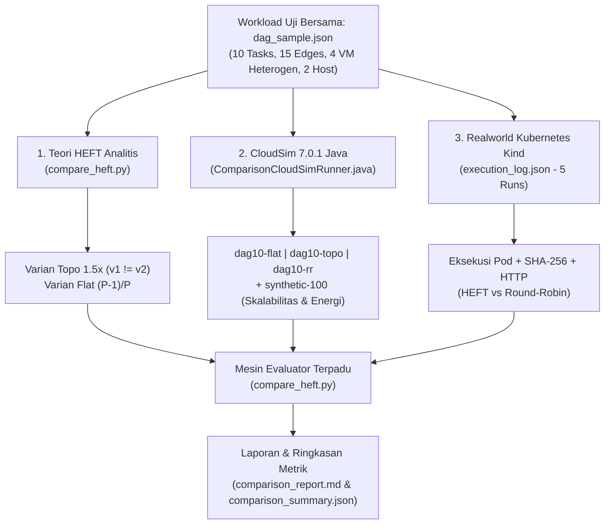
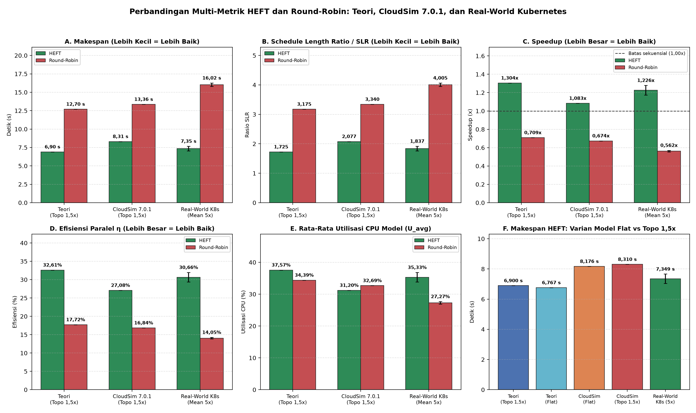
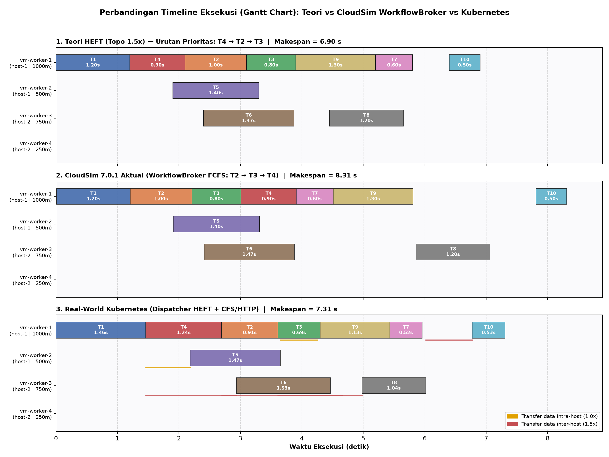
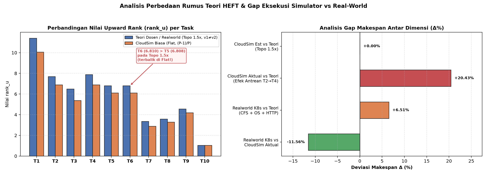

# LAPORAN KOMPARASI TIGA DIMENSI ALGORITMA HEFT
## Perbandingan Teori HEFT (Topcuoglu et al., 2002) terhadap Simulator CloudSim Biasa dan Implementasi Real-World Kubernetes

> **Mata Kuliah:** Strategi Optimasi Komputasi Awan (SOKA) — Semester 5 (Kelas C)  
> **Institusi:** Departemen Teknik Teknologi Informasi, Institut Teknologi Sepuluh Nopember (ITS), Surabaya  
> **Dosen Pengampu:** Henning Titi Ciptaningtyas, S.Kom, M.Kom.  
> **Kelompok 6:**
> 1. Rayhan Agnan Kusuma (5027241102)
> 2. Ahmad Idza Anafin (5027241017)
> 3. Andi Naufal Zaki (5027241059)
> 4. Zidny Ilman Nafi'an (5027221072)

---

## 1. Ringkasan Eksekutif

Laporan ini menyajikan evaluasi komparatif yang objektif dan dapat direproduksi antara **Teori Algoritma HEFT** (*Heterogeneous Earliest Finish Time* — Topcuoglu, Hariri & Wu, 2002) dengan dua proyek implementasi berbeda:
1. **HEFT Simulation Biasa (`heft-simulation-master`):** Simulator *discrete-event* Java berbasis **CloudSim 7.0.1**.
2. **HEFT Simulation Realworld ([`kube-heft-scheduler`](../kube-heft-scheduler)):** Orkestrator Python di atas klaster nyata **Kubernetes (Kind)** dengan pembatasan Linux CFS quota dan komunikasi HTTP antar-pod.

Untuk menghindari perbandingan yang timpang (*apple-to-orange*), dibangun modul eksekusi bersama pada folder [`comparison/`](.) yang mengeksekusi **DAG dan topologi VM yang identik** ([`dag_sample.json`](../kube-heft-scheduler/master/dag_sample.json)) secara nyata di CloudSim 7.0.1 — melengkapi baseline statis yang sebelumnya tertanam pada [`simulator_data.py`](../kube-heft-scheduler/master/simulator_data.py).

**Temuan Utama:**
- Pada sisi **perencanaan matematis**, CloudSim menghasilkan jadwal dan *estimated makespan* yang **100% identik** dengan rumus teorinya (`6.9000 s` pada mode topology-aware dan `6.7667 s` pada mode flat-network).
- Pada sisi **eksekusi event-driven CloudSim**, `WorkflowBroker` menghasilkan *actual makespan* **`8.3097 s`** (topology-aware) dan **`8.1760 s`** (flat), lebih lambat **+20.43%** dari estimasi teoritis karena pelepasan anak-anak `T1` (`T2`, `T3`, `T4`) mengikuti urutan daftar `successors` (`T2 -> T3 -> T4`), bukan urutan prioritas HEFT (`T4 -> T2 -> T3`).
- Pada sisi **klaster Kubernetes nyata (5 run)**, HEFT mencapai rata-rata *makespan* **`7.3492 ± 0.315 s`**, menyimpang **+6.51%** dari teori ideal (`6.9000 s`) akibat *Linux CFS cgroups throttling*, *OS context switching*, dan overhead jaringan HTTP/TCP, sekaligus mengungguli Round-Robin Kubernetes (`16.020 ± 0.234 s`) sebesar **54.12%**.

---

## 2. Metodologi Penyelarasan & Arsitektur Komparasi

Sebelum disandingkan, kedua proyek memiliki perbedaan mendasar dalam skala workload, topologi, dan metrik keluaran. Penyelarasan dilakukan melalui arsitektur berikut:



### Spesifikasi Topologi Uji Bersama (10-Task Topcuoglu DAG)

| VM / Worker | Host Fisik | Limit CPU (K8s) | Kecepatan Relatif | MIPS (CloudSim) |
| :--- | :--- | :---: | :---: | :---: |
| `vm-worker-1` | `host-1` | `1000m` | `1.00x` | `1000` |
| `vm-worker-2` | `host-1` | `500m` | `0.50x` | `500` |
| `vm-worker-3` | `host-2` | `750m` | `0.75x` | `750` |
| `vm-worker-4` | `host-2` | `250m` | `0.25x` | `250` |

- Panjang komputasi di CloudSim disetarakan dengan `MI = base_seconds_on_p1 × 1000`, dan ukuran data transfer disetarakan dengan `Data (MB) = comm_cost × 100 MB/s` (`NETWORK_BANDWIDTH_MBPS = 100.0`).

---

## 3. Perbandingan Implementasi Teori HEFT di Kedua Proyek

Penelusuran langsung terhadap kode sumber menemukan bahwa kedua proyek menerapkan **variasi rumus rata-rata biaya komunikasi ($\bar{c}_{i,j}$)** yang sedikit berbeda dalam Fase 1 (*Task Prioritizing*):

$$\text{rank}_u(n_i) = \bar{w}_i + \max_{n_j \in \text{succ}(n_i)} \left( \bar{c}_{i,j} + \text{rank}_u(n_j) \right)$$

| Aspek Formulasi HEFT | Teori Dosen / Realworld ([`heft_algorithm.py`](../kube-heft-scheduler/master/heft_algorithm.py)) | CloudSim Biasa (`HEFTScheduler.java`) |
| :--- | :--- | :--- |
| **Definisi $\bar{c}_{i,j}$** | Rata-rata hanya atas pasangan VM **berbeda** ($v_1 \neq v_2$), memperhitungkan topologi host | Rata-rata atas **seluruh** $P \times P$ pasangan VM: `networkCost × (P - 1) / P` |
| **Model Jaringan** | Intra-host `1.0x`, Inter-host `1.5x` | Flat (`1.0x` untuk semua VM berbeda pada `100 MB/s`) |
| **Multiplier $\bar{c}$ (4 VM)** | **`1.3333`** | **`0.7500`** |
| **Urutan Prioritas (`priority_order`)** | `T1 -> T4 -> T2 -> T6 -> T5 -> T3 -> T9 -> T8 -> T7 -> T10` | `T1 -> T4 -> T2 -> T5 -> T6 -> T3 -> T9 -> T8 -> T7 -> T10` |
| **Makespan Teoritis HEFT** | **`6.9000 s`** | **`6.7667 s`** |

> **Analisis Akademik:** Karena model Realworld memasukkan penalti inter-host (`1.5x`), komunikasi antar-host mendapat bobot lebih besar pada perhitungan `rank_u`, sehingga `T6` (6.810) naik tepat di atas `T5` (6.808), dan makespan teoritis bertambah `+1.97%` dari `6.7667 s` menjadi `6.9000 s`.

---

## 4. Hasil Komparasi Tiga Dimensi (Metrik Terpadu)

### 4.1. Perbandingan Algoritma HEFT

| Dimensi Evaluasi | Makespan $C_{\max}$ (s) | $SLR$ | Speedup ($S$) | Efficiency ($\eta$) | CPU Util ($U_{\text{avg}}$) | Comm Model (s) |
| :--- | :---: | :---: | :---: | :---: | :---: | :---: |
| **Teori HEFT (Topo 1.5x)** | `6.9000` | `1.7250` | `1.3043x` | `32.61%` | `37.57%` | `6.5500` |
| **Teori HEFT (Flat)** | `6.7667` | `1.6917` | `1.3300x` | `33.25%` | `41.01%` | `6.2000` |
| **CloudSim Biasa (Flat)** | `8.1760` *(est: 6.7667)* | `2.0440` | `1.1008x` | `27.52%` | `33.94%` | `6.2000` |
| **CloudSim (Topo 1.5x)** | `8.3097` *(est: 6.9000)* | `2.0774` | `1.0831x` | `27.08%` | `31.20%` | `6.5500` |
| **Realworld K8s (Mean 5x)** | **`7.3492 ± 0.315`** | `1.837` | `1.226x` | `30.66%` | `35.33%` | `6.550` *(riil: `0.503s`)* |

*(Nilai referensi pada DAG 10-task: $CP_{\min} = 4.00\text{ s}$ dan waktu sekuensial minimum pada VM tercepat $\min_p \sum w_{i,p} = 9.00\text{ s}$.)*

### 4.2. Perbandingan Baseline Round-Robin

| Dimensi Round-Robin | Makespan $C_{\max}$ (s) | $SLR$ | Speedup ($S$) | Efficiency ($\eta$) | CPU Util ($U_{\text{avg}}$) |
| :--- | :---: | :---: | :---: | :---: | :---: |
| **Teori Round-Robin (Topo 1.5x)** | `12.7000` | `3.1750` | `0.7087x` | `17.72%` | `34.39%` |
| **CloudSim Round-Robin (Topo 1.5x)** | `13.3587` | `3.3397` | `0.6737x` | `16.84%` | `32.69%` |
| **Realworld K8s Round-Robin (Mean 5x)** | `16.020 ± 0.234` | `4.005` | `0.562x` | `14.05%` | `27.27%` |

---

## 5. Perbandingan Jadwal Per-Task (`T1`–`T10`)

Tabel berikut menyandingkan hasil penjadwalan **Teori HEFT (Topo)**, **CloudSim 7.0.1 (Topo)**, dan **Kubernetes Realworld (Run Representatif)**:

| Task | $rank_u$ Teori | VM Teori | VM CloudSim | EST → EFT Teori (s) | AST → AFT CloudSim (s) | AST → AFT K8s Aktual (s) |
| :---: | :---: | :--- | :--- | :---: | :---: | :---: |
| **T1** | `11.399` | `vm-worker-1` | `vm-worker-1` | `0.00 → 1.20` | `0.01 → 1.21` | `0.00 → 1.46` |
| **T2** | `7.699` | `vm-worker-1` | `vm-worker-1` | `2.10 → 3.10` | `1.21 → 2.21` | `2.70 → 3.61` |
| **T3** | `6.493` | `vm-worker-1` | `vm-worker-1` | `3.10 → 3.90` | `2.21 → 3.01` | `3.61 → 4.30` |
| **T4** | `7.892` | `vm-worker-1` | `vm-worker-1` | `1.20 → 2.10` | `3.01 → 3.91` | `1.46 → 2.70` |
| **T5** | `6.808` | `vm-worker-2` | `vm-worker-2` | `1.90 → 3.30` | `1.91 → 3.31` | `2.18 → 3.65` |
| **T6** | `6.810` | `vm-worker-3` | `vm-worker-3` | `2.40 → 3.87` | `2.41 → 3.88` | `2.93 → 4.47` |
| **T7** | `3.359` | `vm-worker-1` | `vm-worker-1` | `5.20 → 5.80` | `3.91 → 4.51` | `5.43 → 5.96` |
| **T8** | `3.584` | `vm-worker-3` | `vm-worker-3` | `4.45 → 5.65` | `5.86 → 7.06` | `4.98 → 6.02` |
| **T9** | `4.550` | `vm-worker-1` | `vm-worker-1` | `3.90 → 5.20` | `4.51 → 5.81` | `4.30 → 5.43` |
| **T10** | `1.042` | `vm-worker-1` | `vm-worker-1` | `6.40 → 6.90` | `7.81 → 8.31` | `6.77 → 7.31` |

---

## 6. Analisis Gap & Temuan Kritis

### 6.1. Mengapa Actual Makespan CloudSim (`8.31 s`) Lebih Tinggi dari Estimasi Teori (`6.90 s`)?
Pada kedua mode (`dag10-topo` dan `dag10-flat`), **penempatan VM dan urutan prioritas di CloudSim 100% cocok dengan Teori**. Namun saat eksekusi simulasi dijalankan:
- Setelah `T1` selesai (`t = 1.21 s`), anak-anak yang dialokasikan ke `vm-worker-1` (`T2`, `T3`, `T4`) langsung siap dengan delay komunikasi `0.0 s`.
- `WorkflowBroker` mengirim cloudlet berdasarkan urutan list `task.getSuccessors()` (`T2`, lalu `T3`, lalu `T4`), sehingga `CloudletSchedulerSpaceShared` mengeksekusi secara FCFS: `T2 -> T3 -> T4` (`T4` baru selesai di `3.91 s`).
- Padahal menurut prioritas HEFT (`rank_u`), **`T4` (`7.892`) harus berjalan sebelum `T2` (`7.699`) dan `T3` (`6.493`)** agar transfer inter-host terberat `T4 -> T8` (`1.95 s`) dapat dimulai lebih awal. Pergeseran ini mendorong `T8` dan `T10` mundur `+1.41 s` (`+20.43%`).

### 6.2. Mengapa Realworld Kubernetes (`7.35 s`) Menyimpang `+6.51%` dari Teori (`6.90 s`), Namun Lebih Cepat `-11.56%` dari `WorkflowBroker` CloudSim (`8.31 s`)?
- **Vs Teori (`+6.51%`):** Di klaster Kubernetes, `dispatcher.py` mengirim task sesuai jadwal HEFT (`T4 -> T2 -> T3`), namun waktu eksekusi aktual bertambah oleh pembatasan kuota CPU Linux *CFS cgroups* (`100ms` period), *OS context switch*, dan serialisasi HTTP/JSON di Docker bridge.
- **Vs CloudSim Aktual (`-11.56%`):** `dispatcher.py` pada proyek Realworld menghormati urutan eksekusi `priority_order`/`EST` milik HEFT, sehingga tidak mengalami antrean terbalik `T2 -> T3 -> T4` seperti pada `WorkflowBroker` bawaan.

### 6.3. Komplementaritas Proyek: Skalabilitas & Energi pada CloudSim (100 Task Synthetic)
Proyek **HEFT Simulation Biasa** memiliki cakupan yang tidak dijalankan oleh klaster Kubernetes 4-pod, yaitu uji skala besar dan estimasi konsumsi energi datacenter:
- **Skenario Uji:** `synthetic` 100 Tasks, 171 Edges, 10 VM Heterogen (2 Datacenter, 8 Physical Hosts)
- **HEFT Estimated Makespan:** `174.3612 s`
- **CloudSim Actual Makespan:** `175.0763 s` (selisih hanya `+0.4101%`)
- **CPU Utilization:** `36.84%`
- **Estimasi Energi Datacenter:** `147,317.13 Joule`
- **Scheduling Runtime Algoritma HEFT:** `7.173 ms`

### 6.4. Ringkasan Perbandingan Kedua Proyek

| Kriteria | HEFT Simulation Biasa (`heft-simulation-master`) | HEFT Simulation Realworld (`kube-heft-scheduler`) |
| :--- | :--- | :--- |
| **Platform** | Java + CloudSim 7.0.1 (*Discrete-Event Simulator*) | Python + Kubernetes Kind + Docker Containers |
| **Kekuatan Utama** | Uji skalabilitas besar (100–500 task, DAX Montage/CyberShake/SIPHT), model energi host (Joule), dan runtime algoritma (ms) | Membuktikan perilaku fisik nyata (CFS quota throttling, OS jitter, HTTP/TCP latency) dan komparasi langsung vs Round-Robin |
| **Keterbatasan** | Tidak memodelkan penalti jaringan inter-host (`1.5x`), belum ada baseline pembanding (RR), `WorkflowBroker` mengirim child dalam urutan list bukan prioritas HEFT | Skala uji terbatas (10 task, 4 pod), tidak menghitung konsumsi energi datacenter, dan `simulator_data.py` sebelumnya memakai angka statis |

---

## 7. Visualisasi Hasil Komparasi

Seluruh grafik dihasilkan otomatis oleh [`compare_heft.py`](compare_heft.py) dan tersimpan di folder `results/`:

1. **Komparasi Multi-Metrik (Makespan, HEFT vs RR, SLR & Speedup, Efficiency & CPU Utilization):**
   
2. **Gantt Chart 3-Dimensi (Teori HEFT vs CloudSim WorkflowBroker vs Realworld Kubernetes):**
   
3. **Analisis Rumus Upward Rank & Gap Deviasi ($\Delta\%$):**
   

---

## 8. Cara Reproduksi & Artefak Output

Jalankan seluruh rangkaian komparasi (kompilasi Java, 4 skenario CloudSim 7.0.1, dan evaluasi Python) dari folder `comparison/`:

```powershell
.\run_comparison.ps1
```

Artefak hasil eksekusi tersimpan di folder `results/`:
- [`results/comparison_report.md`](results/comparison_report.md) — Laporan ringkas hasil generator otomatis.
- [`results/comparison_summary.json`](results/comparison_summary.json) — Seluruh metrik dan jadwal per-task dalam format JSON.
- [`results/cloudsim_10task_flat.json`](results/cloudsim_10task_flat.json), [`results/cloudsim_10task_topo.json`](results/cloudsim_10task_topo.json), [`results/cloudsim_10task_rr.json`](results/cloudsim_10task_rr.json), [`results/cloudsim_synthetic_100.json`](results/cloudsim_synthetic_100.json) — Log mentah simulasi CloudSim 7.0.1.

---

## 9. Daftar Pustaka

1. H. Topcuoglu, S. Hariri, and M. -Y. Wu, "Performance-effective and low-complexity task scheduling for heterogeneous computing," *IEEE Transactions on Parallel and Distributed Systems*, vol. 13, no. 3, pp. 260–274, Mar. 2002.
2. R. N. Calheiros, R. Ranjan, C. A. F. De Rose, and R. Buyya, "CloudSim: a toolkit for modeling and simulation of cloud computing environments and evaluation of resource provisioning algorithms," *Software: Practice and Experience*, vol. 41, no. 1, pp. 23–50, 2011.
3. Kubernetes Documentation, "Resource Management for Pods and Containers: CPU CFS Bandwidth Control," *Kubernetes.io*, 2026.
