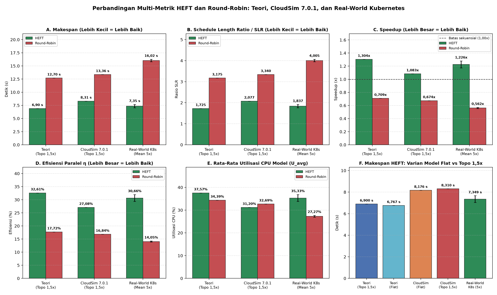
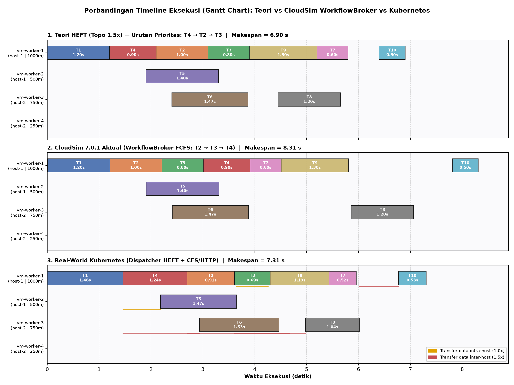
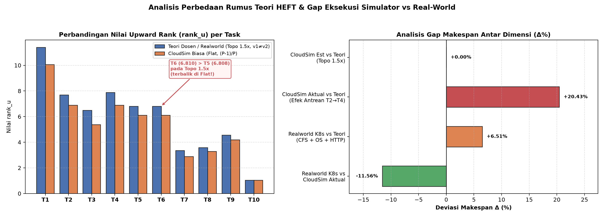

# Laporan Komparasi Tiga Dimensi: Teori HEFT vs CloudSim (Simulation Biasa) vs Kubernetes (Simulation Realworld)

> **Workload Uji Bersama:** `Topcuoglu_2002_10_Task_DAG_4VM` (10 Task, 15 Edge, 4 VM Heterogen pada 2 Host)

## 1. Perbandingan Rumus Teori HEFT pada Kedua Proyek

| Aspek Formulasi HEFT | Teori Dosen / Realworld (`heft_algorithm.py`) | CloudSim Biasa (`HEFTScheduler.java`) | Dampak pada DAG 10-Task |
| :--- | :--- | :--- | :--- |
| **Rata-rata Bobot Komunikasi ($\bar{c}$)** | Pasangan VM berbeda ($v_1 \neq v_2$) + penalti inter-host 1.5x (multiplier = `1.3333`) | Seluruh pasangan $P \times P$ (`(P-1)/P` = `0.7500`), flat 100 MB/s | Nilai $rank_u$ berbeda secara absolut |
| **Urutan Prioritas (`priority_order`)** | `T1 -> T4 -> T2 -> T6 -> T5 -> T3 -> T9 -> T8 -> T7 -> T10` | `T1 -> T4 -> T2 -> T5 -> T6 -> T3 -> T9 -> T8 -> T7 -> T10` | **Berbeda urutan** |
| **Makespan Teoritis HEFT** | **6.9000 s** | **6.7667 s** | Selisih model jaringan: +1.97% |

## 2. Tabel Komparasi Metrik Utama (HEFT Across All Dimensions)

| Dimensi Evaluasi | Makespan (s) | SLR | Speedup | Efficiency (η) | CPU Util (%) | Comm Model (s) |
| :--- | :---: | :---: | :---: | :---: | :---: | :---: |
| Teori HEFT (Topo 1.5x) | 6.9000 | 1.7250 | 1.3043x | 32.61% | 37.57% | 6.5500 |
| Teori HEFT (Flat) | 6.7667 | 1.6917 | 1.3300x | 33.25% | 41.01% | 6.2000 |
| CloudSim Biasa (Flat) | 8.1760 | 2.0440 | 1.1008x | 27.52% | 33.94% | 6.2000 |
| CloudSim (Topo 1.5x) | 8.3097 | 2.0774 | 1.0831x | 27.08% | 31.20% | 6.5500 |
| **Realworld K8s (Mean 5x)** | **7.349 ± 0.315** | 1.837 | 1.226x | 30.66% | 35.33% | 6.550 (riil: 0.503s) |

### Perbandingan Baseline Round-Robin (Teori vs CloudSim vs Kubernetes)

| Dimensi Round-Robin | Makespan (s) | SLR | Speedup | Efficiency (η) | CPU Util (%) |
| :--- | :---: | :---: | :---: | :---: | :---: |
| Teori Round-Robin (Topo 1.5x) | 12.7000 | 3.1750 | 0.7087x | 17.72% | 34.39% |
| CloudSim Round-Robin (Topo 1.5x) | 13.3587 | 3.3397 | 0.6737x | 16.84% | 32.69% |
| Realworld K8s Round-Robin (Mean 5x) | 16.020 ± 0.234 | 4.005 | 0.562x | 14.05% | 27.27% |

## 3. Analisis Gap & Kesesuaian Jadwal (*Schedule Fidelity*)

- **CloudSim (Topo) vs Teori (Topo):** Kecocokan urutan prioritas = `True`, kecocokan penempatan VM = **100.0%**, estimated makespan CloudSim = `6.9000s` (0.00% vs Teori `6.9000s`), sedangkan actual makespan CloudSim = `8.3097s` (**+20.43%**). *Penyebab:* `WorkflowBroker` mengirim cloudlet anak berdasarkan urutan daftar `successors` (`T2 -> T3 -> T4`) saat `T1` selesai bersamaan, sehingga `CloudletSchedulerSpaceShared` mengeksekusi FCFS alih-alih urutan prioritas HEFT (`T4 -> T2 -> T3`).
- **CloudSim (Flat) vs Teori (Flat):** Kecocokan urutan prioritas = `True`, kecocokan penempatan VM = **100.0%**, estimated makespan CloudSim = `6.7667s` (vs Teori `6.7667s`), actual makespan CloudSim = `8.1760s` (**+20.83%**).
- **Realworld K8s vs Teori (Topo):** Makespan riil Kubernetes `7.349s` vs Teori `6.900s` $\rightarrow$ Gap = **+6.51%** (disebabkan *Linux CFS cgroups throttling*, *OS scheduling jitter*, dan overhead HTTP/TCP di Docker bridge).
- **Realworld K8s vs CloudSim Aktual (Topo):** Makespan riil Kubernetes `7.349s` vs CloudSim `8.310s` $\rightarrow$ Gap = **-11.56%** (Kubernetes lebih cepat dari `WorkflowBroker` default karena `dispatcher.py` mengirim task sesuai urutan `priority_order`/`EST` HEFT, tidak tertukar `T2` sebelum `T4`).
- **Realworld K8s vs CloudSim Biasa (Flat):** Makespan riil Kubernetes `7.349s` vs CloudSim Flat `8.176s` $\rightarrow$ Gap = **-10.11%**.

## 4. Perbandingan Per-Task (`T1`–`T10`): Teori vs CloudSim vs Kubernetes (Run Representatif)

| Task | $rank_u$ Teori | VM Teori | VM CloudSim (Topo) | EST→EFT Teori (s) | AST→AFT CloudSim (s) | AST→AFT K8s Aktual (s) |
| :--- | :---: | :--- | :--- | :---: | :---: | :---: |
| **T1** | 11.399 | `vm-worker-1` | `vm-worker-1` | 0.00 → 1.20 | 0.01 → 1.21 | 0.00 → 1.46 |
| **T2** | 7.699 | `vm-worker-1` | `vm-worker-1` | 2.10 → 3.10 | 1.21 → 2.21 | 2.70 → 3.61 |
| **T3** | 6.493 | `vm-worker-1` | `vm-worker-1` | 3.10 → 3.90 | 2.21 → 3.01 | 3.61 → 4.30 |
| **T4** | 7.892 | `vm-worker-1` | `vm-worker-1` | 1.20 → 2.10 | 3.01 → 3.91 | 1.46 → 2.70 |
| **T5** | 6.808 | `vm-worker-2` | `vm-worker-2` | 1.90 → 3.30 | 1.91 → 3.31 | 2.18 → 3.65 |
| **T6** | 6.810 | `vm-worker-3` | `vm-worker-3` | 2.40 → 3.87 | 2.41 → 3.88 | 2.93 → 4.47 |
| **T7** | 3.359 | `vm-worker-1` | `vm-worker-1` | 5.20 → 5.80 | 3.91 → 4.51 | 5.43 → 5.96 |
| **T8** | 3.584 | `vm-worker-3` | `vm-worker-3` | 4.45 → 5.65 | 5.86 → 7.06 | 4.98 → 6.02 |
| **T9** | 4.550 | `vm-worker-1` | `vm-worker-1` | 3.90 → 5.20 | 4.51 → 5.81 | 4.30 → 5.43 |
| **T10** | 1.042 | `vm-worker-1` | `vm-worker-1` | 6.40 → 6.90 | 7.81 → 8.31 | 6.77 → 7.31 |

## 5. Konteks Skalabilitas CloudSim (`TUGAS HEFT`: 100 Task Synthetic, 10 VM)

Kemampuan yang hanya ada di **HEFT Simulation Biasa (CloudSim)** untuk uji skala besar & konsumsi energi:

- **Workload:** 100 Tasks, 171 Edges, 10 VM Heterogen (2 Datacenter, 8 Physical Hosts)
- **HEFT Estimated Makespan:** `174.3612 s`
- **CloudSim Actual Makespan:** `175.0763 s` (Selisih: `+0.4101%`)
- **CPU Utilization:** `36.84%`
- **Estimasi Energi Datacenter:** `147317.13 Joule`
- **HEFT Scheduling Runtime:** `11.991 ms`

## 6. Grafik Komparasi

- `comparison_metrics.png`

- `gantt_3way.png`

- `gap_and_rank_analysis.png`

